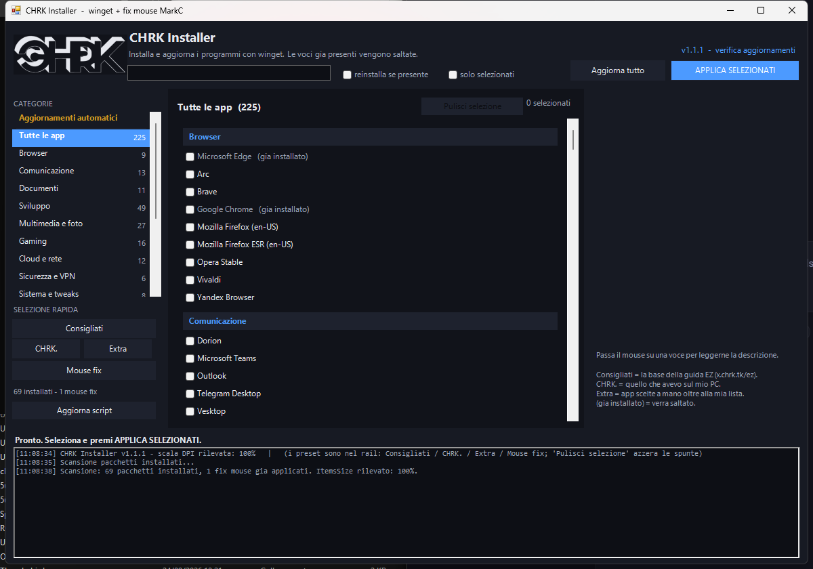

# CHRK Installer

Installer personale con **winget** (GUI WinForms), piu' una manciata di tweak di registro
(fix mouse MarkC). Un solo file `.ps1` autocontenuto.

```
irm https://ez.chrk.tk | iex
```




## Guida FORMAT EZ

La guida per formattare Windows in modo pulito, in versione web (bottoni *Copia*, tema
chiaro/scuro, stampabile in PDF): **<https://cchrkk.github.io/chrk-installer/format-ez.html>**
· sorgente in [`docs/format-ez.html`](docs/format-ez.html), servita da GitHub Pages
(branch `main`, cartella `/docs`).

## Cosa fa

- **All'avvio la GUI preseleziona le app consigliate** (la base della guida
  [x.chrk.tk/ez](https://x.chrk.tk/ez)): su un PC nuovo premi solo `APPLICA SELEZIONATI`.
- **Rail delle categorie a sinistra** (Browser, Documenti, Sviluppo, Mouse, ...) e lista a
  destra con le intestazioni di categoria, ricerca e descrizione di ogni voce passando il
  mouse.
- **Rileva cosa e' gia' installato** e lo salta (segna le voci come `(gia installato)`).
- **Avanzamento chiaro**: pacchetto corrente, `n/totale`, percentuale, media per pacchetto,
  ETA ed esito di ogni voce (`OK` / `SKIP` / `FAIL` con motivo).
- **Preset** (rail, *SELEZIONE RAPIDA*): `Consigliati` (la base della guida
  [x.chrk.tk/ez](https://x.chrk.tk/ez): browser, VLC, 7zip, Steam, Git, editor, utility),
  `CHRK.` (la lista dell'autore), `Extra` (scelte a mano), `Mouse fix`, piu' `Pulisci
  selezione` nell'intestazione della lista.
- **Aggiornamento automatico**: sezione dedicata dentro la lista - crea/rimuove il task di
  Windows che esegue `winget upgrade --all` ogni N giorni all'ora scelta, con lo stato e la
  prossima esecuzione in chiaro. **Parte solo a PC inattivo da 10 minuti** (`RunOnlyIfIdle`),
  quindi mai durante giochi o lavoro: se l'ora salta a PC spento lo fa alla prima finestra
  libera, non appena accendi.
- **Tweaks di Windows** (dalla guida EZ): estensioni visibili in Explorer, file nascosti,
  Esplora file su "Questo PC", barra senza widget/chat/visualizzazione attivita, niente
  ricerca Bing, Copilot spento, niente suggerimenti e pubblicita in Start e Impostazioni,
  piu' una voce che **ripristina i valori originali**.
- **Wizard e script**: **MAS** (attivazione Windows/Office) e **WinUtil** (debloat) si aprono
  da soli in una finestra da amministratore: l'installer scarica il file ufficiale del
  progetto (`.cmd` di MAS, `winutil.ps1` di WinUtil) e lo esegue. Nessun `irm <url> | iex`
  sulla riga di comando, che e' la firma che Defender blocca; se il download non riesce,
  ripiega sul comando negli appunti (Ctrl+V e Invio).
- **Fix mouse MarkC** selezionabili: 1:1 @6/11 per la propria scala DPI (rilevata), emulazioni
  W95/98 e W2K, disattivazione accelerazione su login, ripristino default.
- **Auto-aggiornamento**: `-SelfUpdate` o il pulsante nella GUI.

## Installazione

```powershell
# un comando (scarica, si auto-installa in %LOCALAPPDATA% e parte)
irm https://ez.chrk.tk | iex

# con preset
& ([ScriptBlock]::Create((irm 'https://ez.chrk.tk'))) -Preset recommended

# scaricando il file
irm https://ez.chrk.tk -OutFile "$env:USERPROFILE\CHRK-Installer.ps1"
powershell -ExecutionPolicy Bypass -File "$env:USERPROFILE\CHRK-Installer.ps1"
```

> Su un Windows appena installato la **ExecutionPolicy e' `Restricted`**: `irm | iex` funziona
> lo stesso (non e' un file), e lo script si riavvia dalla copia locale alzando la policy
> **solo per il suo processo** (`-Scope Process`, nessun admin). Per lanciare il `.ps1`
> scaricato a mano serve invece `-ExecutionPolicy Bypass`, come nell'esempio sopra.
> Se e' una policy di gruppo a bloccare gli script, l'installer parte comunque in memoria,
> ma cronjob e auto-aggiornamento restano spenti.

## Uso da riga di comando

```powershell
.\CHRK-Installer.ps1                        # GUI, con le app consigliate gia' spuntate
.\CHRK-Installer.ps1 -Preset none           # GUI senza preselezione
.\CHRK-Installer.ps1 -Preset mine           # GUI con la mia lista
.\CHRK-Installer.ps1 -Preset mouse          # rileva la scala DPI e preseleziona il fix giusto
.\CHRK-Installer.ps1 -Console               # solo elenco, non installa niente
.\CHRK-Installer.ps1 -Console -Preset recommended -DryRun
.\CHRK-Installer.ps1 -Select 'Git.Git','mouse-1to1-100' -Console
.\CHRK-Installer.ps1 -UpgradeAll            # aggiorna tutto (usato dal cronjob)
.\CHRK-Installer.ps1 -ShowVersion
.\CHRK-Installer.ps1 -SelfUpdate
.\CHRK-Installer.ps1 -InstallCron -EveryDays 7 -CronTime 03:00
.\CHRK-Installer.ps1 -RemoveCron
```

| Parametro | Effetto |
|---|---|
| `-Preset recommended\|ez\|mine\|extra\|mouse\|all\|none` | preselezione (default della GUI: `recommended`; in console si applica solo se lo passi esplicitamente) |
| `-Select <id,id>` | selezione esplicita |
| `-Console` | niente GUI |
| `-DryRun` | non modifica nulla, mostra cosa farebbe |
| `-ForceReinstall` | reinstalla anche cio' che risulta presente |
| `-UpgradeAll` | `winget upgrade --all` |
| `-InstallCron` / `-RemoveCron` | gestione task pianificato |
| `-CronElevated` | task elevato (richiede admin, sconsigliato con winget) |
| `-SelfUpdate` / `-ShowVersion` | aggiornamento e versione |
| `-NoSelfInstall` | se eseguito in memoria, non si copia su disco |

## Come e' fatto il repository

```
├─ VERSION                          versione corrente (la usa il build)
├─ dist/CHRK-Installer.ps1          ARTEFATTO pubblicato (autocontenuto, non modificare a mano)
├─ build/
│  ├─ build.ps1                     compila dist/ partendo dai dati sotto
│  ├─ chrk-installer.template.ps1   sorgente dello script, con i placeholder
│  ├─ catalog-mine.json             export winget dell'autore -> preset "CHRK."
│  ├─ ez.json                       app di base consigliate (guida x.chrk.tk/ez)
│  ├─ guide.json                    altre app della guida EZ (selezionabili, non nella base)
│  ├─ exclude.json                  id da NON mettere nel catalogo
│  ├─ extras.json                   pacchetti extra (preset "Extra")
│  ├─ names.json                    nomi/descrizioni manuali di riserva
│  ├─ mousefixes.inc                fix mouse MarkC gia' estratti
│  ├─ tweaks.inc                    tweak di Windows + wizard (MAS, WinUtil)
│  └─ assets/logo.png|svg           logo (png = embeddato)
├─ docs/                            architettura, pubblicazione, fix mouse
├─ tools/export-winget.ps1          rigenera catalog-mine.json + lista app manuali
├─ tools/shots.ps1                  (dev) avvia la GUI e ne salva uno screenshot
└─ .github/workflows/               build automatico
```

Per ricompilare:

```powershell
.\build\build.ps1                     # usa VERSION
.\build\build.ps1 -Version 1.1.0
```

## Pubblicazione

Vedi **[docs/publishing.md](docs/publishing.md)**: repo GitHub + proxy Cloudflare su
`ez.chrk.tk` (redirect o Worker).

## Crediti e licenza

- Logica di install via winget derivata da [WinUtil](https://github.com/ChrisTitusTech/winutil) (MIT).
- Descrizioni app da [winstall.app](https://winstall.app) e dal catalogo WinUtil.
- Fix mouse: **MarkC Mouse Acceleration Fix Builder** (valori di registro, vedi
  [docs/mousefixes.md](docs/mousefixes.md)).
- Codice di questo progetto: [MIT](LICENSE).

> Ninite e' un marchio di Ninite LLC. Questo progetto non e' affiliato.
